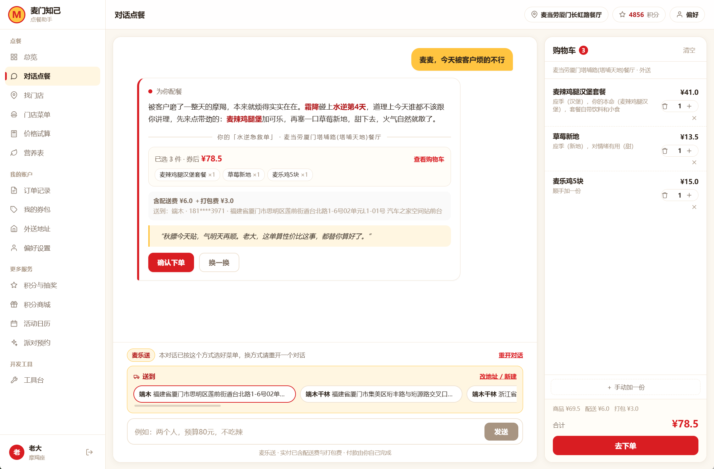
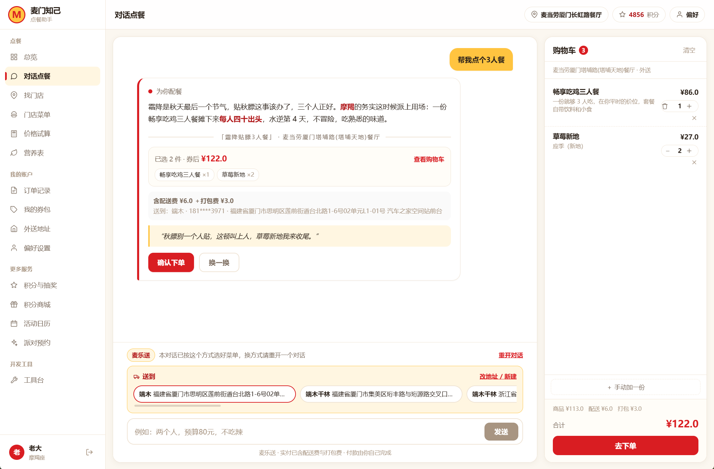

# 麦门知己 · 不止点餐，是懂你

一个能接住「我好烦啊」的麦当劳点餐 Agent。

大多数点餐助手只会算账：你说"4个人150块不辣"，它给你凑一单。
但人是带着情绪去吃饭的。**「麦门知己」先听懂你为什么烦，再决定让你吃什么。**

> 说一句话，它给你一份带理由的菜单 —— 理由里可能是"霜降了该贴秋膘"，
> 也可能是"上周四你也是这么烦的，那天麦麦鸡治好了你"。

WaytoAGI 1024 超能 Coding 周末 · 用餐赛道



> 上图是真实运行界面：左侧对话只说了一句「被客户烦的不行」，
> 右侧就已经是加好购物车、算好价的完整一单。

---

## 能做什么

### 场景① 情绪输入：「我好烦啊」

用户只说了「被客户烦的不行」——没给人数、没给预算、没说要吃什么。
（就是开头那张图。）

```
你：我好烦啊

它：收到。水逆第 3 天（我记得，你 22 号就开始跟我抱怨代码了），
    霜降刚过一天，天一冷人就容易烦——这是宇宙的锅，不是你的。
    对了，明天就是你生日，天蝎座寿星本周宜甜食续命。我给你安排了：

    ── 你的「水逆急救单」· 留仙洞店 ──
    新地（巧克力）    ×1                甜度抵消 30% 烦躁         ¥11.5
    麦辣鸡翅          ×2                烦就要吃辣，物理发泄       ¥16.0
    冰鲜柠檬水        去冰 · 你上次说的   霜降了还是留了点冰的自由    ¥9.5
    热可可            ×1                霜降限定情绪，热乎的才对    ¥13.0

    券后实付 ¥39.5  原价 ¥50.0                    热量 ≈ 720 kcal

    "宇宙没善待你，但优惠券有。上周四你烦的时候吃了麦麦鸡说治愈
     ——这次加个热可可，霜降嘛，麦门。"
```

它做了这些事：识别情绪 → 查节气（霜降）→ 查水逆（第 3 天）→ 查生日（明天）→
读记忆（怕你烦躁、可乐去冰）→ 按情绪策略选品（烦躁→甜+辣+冰）→ 排除忌口 → 算券后价。

### 场景② 明确指令：「4个人150块，有人不吃辣」

预算装箱 + 忌口硬过滤 + 按人数配数量，一分钱不超。

用户说「帮我点个 3 人餐」，它给一份「霜降贴膘 3 人餐」——
三人正好吃三人餐，人均四十出头，配两个草莓新地收尾：



注意右侧购物车：不是把推荐塞给你就完了，是一件件加进车里、实时算价，
**付款由你自己完成**（底部「去下单」）。

> 两张图都是**真实运行截图**，不是设计稿：右上角是已登录账号（积分 536），
> 商品价格、配送费、打包费均来自麦当劳 MCP 实时返回。

### 场景③ 老用户回归：「我又来了」

```
它：哟，麦小门。三天不见，我可都记着呢——上周四你烦躁，麦麦鸡治好了你；
    你的可乐永远去冰；还有，明天你生日。
```

**记忆是这个产品的核心。** 用得越久，它越不需要你重复自己。

---

## 快速开始（本地跑，5 步）

### 1. 环境要求

- **Node.js ≥ 22**（用了内置 `node:sqlite`，编译零依赖）
- 一个麦当劳 MCP Token：打开 [open.mcd.cn](https://open.mcd.cn) 扫码登录 → 控制台激活 → 复制 Token

### 1.1 MCP 怎么配

仓库根目录的 [`mcp-config.example.json`](mcp-config.example.json) 是 MCP 连接配置示例，
所有凭证都用环境变量占位符（`${MCD_MCP_TOKEN}`），文件里没有任何真实 Token。

**两种用法，注意区分：**

**① 在 WorkBuddy / Claude 等 MCP 宿主里直接跑（推荐用于体验 MCP 能力）**

把示例里的占位符换成本机环境变量名，粘进宿主的连接器配置即可：

```json
{
  "mcpServers": {
    "mcd-mcp": {
      "type": "streamablehttp",
      "url": "https://mcp.mcd.cn",
      "headers": { "Authorization": "Bearer ${MCD_MCP_TOKEN}" }
    }
  }
}
```

**② 跑本项目（Token 不进配置文件）**

本项目**不需要**把 Token 写进 `mcp-config.example.json`。
架构上 Token 由用户登录时粘贴一次，服务端用 AES-256-GCM 加密落库，
每次调用前在内存解密再注入请求头（见 `server/src/mcp/gateway.ts`）。

所以你只需要在 `server/.env` 里配端点：

```bash
MCP_ENDPOINT=https://mcp.mcd.cn
```

然后启动服务，在浏览器里粘贴 Token。

> ⚠️ `mcp-config.example.json` 是**给人参考格式**的，服务不会读它。
> 真要跑本项目，改的是 `server/.env`。

### 2. 拉代码装依赖

```bash
git clone <your-repo-url> mcd-soulmate
cd mcd-soulmate
```

前后端依赖分开装（两端各自独立）：

```bash
cd server && npm install
cd ../web && npm install
```

### 3. 配置环境变量

```bash
cd ../server
cp .env.example .env
```

生成两个必须的密钥并填进 `.env`：

```bash
openssl rand -hex 32   # → 填给 JWT_SECRET
openssl rand -hex 32   # → 填给 TOKEN_ENC_KEY（必须是 64 位 hex）
```

`LLM_API_KEY` 可以留空 —— 留空时回复走内置模板，功能完整只是文案没那么灵动。

### 4. 构建并启动

先构建前端（产物落在 `web/dist`，服务端会自动托管它）：

```bash
cd ../web && npm run build
```

再构建并启动后端：

```bash
cd ../server
npm run build
npm start
```

看到这两行就成功了：

```
静态前端：/path/to/mcd-soulmate/web/dist
✅ 麦门知己后端已启动 http://localhost:3000
```

### 5. 打开浏览器

访问 **http://localhost:3000** → 粘贴你的 Token → 开始聊。

> 后端开发模式用 `npm run dev`（tsx watch，改代码自动重启）。
> 前端开发模式另开一个终端 `cd web && npm run dev`（Vite HMR，默认 5173 端口，已配好 API 代理）。

### 只想看看界面，不想配 Token？

前端内置了一套 mock 数据层，加上 `?mock=1` 就能不连后端走完三个场景：

```bash
cd web && npm run dev
# 打开 http://localhost:5173/?mock=1
```

mock 模式下任意 20 位以上的字符串都能登录（不校验 Token 格式）。

> ⚠️ 不能直接用 `python -m http.server` 打开 `web/index.html` ——
> 那是 Vite 的源码入口，引用的是 `/src/main.ts`，必须经过 Vite 处理才能跑。

---

## 部署到自己的服务器

目标：单台 Linux 服务器，单进程，零外部 SaaS 依赖。

### 前置

```bash
# Node 22
curl -fsSL https://deb.nodesource.com/setup_22.x | sudo -E bash -
sudo apt install -y nodejs nginx sqlite3

# pm2
sudo npm i -g pm2
```

### 第 1 步：放代码 + 配置

```bash
sudo mkdir -p /var/www/mcd-soulmate
sudo chown -R $USER:$USER /var/www/mcd-soulmate
git clone <your-repo-url> /var/www/mcd-soulmate
cd /var/www/mcd-soulmate/server

cp .env.example .env
# 填 JWT_SECRET / TOKEN_ENC_KEY / LLM_API_KEY，并把 NODE_ENV 改为 production
chmod 600 .env          # 重要：别让同机器上其他用户读到
```

### 第 2 步：自检

```bash
bash ../scripts/preflight.sh
```

会输出一份 ✅/❌ 清单：Node 版本、密钥格式、数据目录权限、端口占用、MCP 连通性、构建产物。
**全部 ✅ 再继续。**

### 第 3 步：构建 + 启动

```bash
npm ci && npm run build
pm2 start ecosystem.config.js
pm2 startup         # 按提示执行它输出的那行 sudo 命令
pm2 save            # 保存进程列表，服务器重启后自动恢复
```

> ⚠️ `ecosystem.config.js` 里 `instances` 必须是 **1**。
> SQLite 单文件写锁 + 内存连接池都是进程内状态，开 cluster 多实例会互相踩
> （订单幂等失效、连接池重复建连、限流计数不准）。

### 第 4 步：Nginx

```bash
sudo cp ../nginx/mcd-soulmate.conf /etc/nginx/sites-available/mcd-soulmate.conf
sudo nano /etc/nginx/sites-available/mcd-soulmate.conf   # 改 your-domain.com 和路径
sudo ln -s /etc/nginx/sites-available/mcd-soulmate.conf /etc/nginx/sites-enabled/
sudo nginx -t && sudo systemctl reload nginx
```

**SSE 必须关缓冲**，否则流式回复会卡住一次性蹦出来。配置里已经写好了：

```nginx
location /api/ {
    proxy_buffering off;
    proxy_cache off;
    proxy_read_timeout 120s;
    proxy_http_version 1.1;
    proxy_set_header Connection '';
    gzip off;
}
```

### 第 5 步：HTTPS

```bash
sudo apt install -y certbot python3-certbot-nginx
sudo certbot --nginx -d your-domain.com
```

certbot 会自动改写 nginx 配置并配好续期。验证续期：`sudo certbot renew --dry-run`

> **全站 HTTPS 是部署红线** —— Cookie 里是会话凭证，走 HTTP 会明文泄露。

### 第 6 步：备份 cron

```bash
crontab -e
```

```cron
# 每日 3:00 备份（注意 % 必须转义为 \%）
0 3 * * * bash /var/www/mcd-soulmate/scripts/backup.sh >> /var/www/mcd-soulmate/logs/backup.log 2>&1
```

手动验证一次：

```bash
bash /var/www/mcd-soulmate/scripts/backup.sh
```

输出里有 `integrity_check = ok` 就对了。

> 💡 **为什么不能直接 `cp mcd.db`**：服务运行时 WAL 有未落盘数据，
> 直接拷贝会拿到不一致的快照。脚本用的是 `sqlite3 .backup`（官方在线备份 API）。

### 第 7 步：后续更新

```bash
bash /var/www/mcd-soulmate/scripts/deploy.sh
```

幂等脚本：拉代码 → 装依赖 → 构建 → `pm2 reload`（零停机）→ 健康检查。
失败会在对应步骤退出并打印日志。

```bash
bash scripts/deploy.sh --with-preflight   # 首次部署建议带上自检
bash scripts/deploy.sh --no-pull          # 只重新构建，不拉代码
```

---

## 环境变量说明

| 变量 | 必填 | 默认 | 说明 |
|---|---|---|---|
| `JWT_SECRET` | ✅ | — | 会话签名密钥，≥32 字符。`openssl rand -hex 32` |
| `TOKEN_ENC_KEY` | ✅ | — | Token 加密密钥，**必须 64 位 hex**。换掉会让所有已存 Token 失效 |
| `PORT` | | `3000` | 监听端口 |
| `NODE_ENV` | | `development` | 生产环境填 `production` |
| `DATA_DIR` | | `./data` | SQLite 文件目录 |
| `MCP_ENDPOINT` | | `https://mcp.mcd.cn` | 麦当劳 MCP 端点 |
| `MCP_VERIFY_SKIP` | | `0` | **`1` 只用于开发**。为 1 时跳过 Token 真实性校验，生产必须为 0 |
| `DEBUG_MCP` | | `0` | `1` 时打印 MCP 请求/响应（已脱敏） |
| `LLM_BASE_URL` | | `https://api.deepseek.com/v1` | OpenAI 兼容接口 |
| `LLM_API_KEY` | | 空 | 留空则走模板兜底，功能不受影响 |
| `LLM_MODEL` | | `deepseek-chat` | 模型名 |
| `LLM_TIMEOUT_MS` | | `20000` | 单次调用超时 |
| `GUEST_DAILY_LIMIT` | | `1` | 访客每 IP 每日免费次数 |

**配置错误时服务会拒绝启动**并打印缺失项，不会用默认弱密钥带病运行。

---

## 架构

```
                        ┌─────────────────────────────┐
  浏览器                 │  web/  Vue 3 + Vite + TS     │
   │                    │  17 个视图 · 手写 CSS 令牌    │
   │  POST /api/chat    └─────────────────────────────┘
   │  text/event-stream              │
   ▼                                 ▼
┌──────────────────────────────────────────────────────────┐
│  Express 5 · 单进程 · instances=1                         │
│                                                          │
│  ⓪ 身份层    JWT cookie → userId = sha256(token)[0:16]    │
│              ↓ Token 解密（AES-256-GCM，内存中）           │
│  ① 意图层    规则引擎：情绪 / 人数 / 预算 / 忌口            │
│              ↓ 置信度 <0.4 才让 LLM 兜底                   │
│  ② 知识层    节气 · 星座 · 水逆 · 时段 · 情绪策略           │
│              ↓                                            │
│  ③ 选品层    确定性打分（+3/+2/-5…），忌口硬过滤            │
│              ↓                                            │
│  ④ 校准层    MCP gateway：连接池 · 缓存 · 限流             │
│              ↓                                            │
│  ⑤ 表达层    LLM 只写 hook/quote，失败走模板               │
│              ↓                                            │
│  ⑥ 交易层    create-order → payUrl（支付永远由用户完成）    │
│                                                          │
│  SQLite（WAL）   users · memories · mood_diary ·           │
│                  orders · chats · guest_usage             │
└──────────────────────────────────────────────────────────┘
                              │
                              ▼
                    麦当劳 MCP（35 个工具，调用 23 个）
```

### 三条关键设计决策

**1. 单体不拆微服务**

演示规模下单进程绰绰有余，拆开只会让部署变复杂、让 SSE 跨进程传递变得麻烦。
`instances: 1` 是刻意的，不是偷懒。

**2. 规则做"想"，LLM 只做"说"**

这是最硬的一条边界：

- 情绪识别 → 规则引擎（关键词 + 优先级 + 反讽检测）
- 节气/星座映射 → 静态查表
- 选品 → 确定性打分（同输入必然同输出，可单元测试）
- **只有 hook/quote 的措辞交给 LLM**

代价是文案不如纯 LLM 灵活，收益是**演示绝不翻车**：断网、LLM 挂了、MCP 挂了，
菜单都还是对的。LLM 只是让它说得更好听。

**3. Token 服务端持有，用户不感知**

用户粘贴一次 Token，之后所有 MCP 调用都由服务端代持 —— 前端永远看不到 Token，
浏览器只拿一个 httpOnly Cookie。这让"AI 用你自己的会员账号下单"成为可能，
同时把 Token 泄露面压到最小。

---

## 安全与隐私

| 项 | 做法 |
|---|---|
| **Token 存储** | AES-256-GCM 加密后落库，格式 `base64(iv12‖tag16‖ciphertext)`。明文只在内存中存在 |
| **Token 日志** | 所有日志出口过 `sanitize()`，Token 显示为 `abcd****wxyz` |
| **Token 传输** | httpOnly Cookie `mcd_sid`（SameSite=Lax），前端 JS 读不到 |
| **记忆可删** | 记忆管理页逐条删除，或输「删除」二字一次性解绑清空全部数据 |
| **不代付** | `create-order` 只返回 `payUrl` 并透传展示。**代码库中没有任何支付/退款路径** |
| **金额不可篡改** | 服务端用 `calculate-price` 重算，**永不相信前端传来的金额** |
| **越权防护** | 所有订单操作校验 `orders.user_id === req.userId`；confirm 时还校验 `menuHash` 快照 |
| **SQL 注入** | 全参数化查询 |
| **密钥管理** | 缺失或格式错误直接拒绝启动；`.env` 在 `.gitignore` 里；`chmod 600` |
| **限流** | 每用户 20 req/min、全局 550 req/min（平台 600，留 50 边际） |

安全审计的完整记录（8 项扫描的真实输出）在 [docs/security-audit.md](docs/security-audit.md)。

---

## 常见问题

**Q：Token 从哪来？**

[open.mcd.cn](https://open.mcd.cn) → 扫码登录 → 控制台激活 → 复制 Token。免费。

**Q：Token 失效了怎么办？**

重新去 open.mcd.cn 生成一个，在登录页粘贴即可。
注意：**换 Token = 新身份 = 新记忆库**（userId 由 token 派生，这是设计取舍）。
旧记忆仍在服务端，用旧 Token 还能登回去看。

**Q：提示 429 了？**

两层限流：本服务（每用户 20 次/分钟）和麦当劳平台（600 次/分钟）。
等一分钟再试。如果是访客模式，可能是当日免费次数用完了 —— 登录后不限。

**Q：能不能不登录直接用？**

可以，访客模式每天 1 次免费对话。但访客没有记忆，
这个产品最值钱的部分（"它记得你"）就体验不到了。

**Q：数据存在哪？**

你自己服务器上的 `server/data/mcd.db`（SQLite）。没有第三方，没有云数据库。
备份用 `scripts/backup.sh`。

**Q：MCP 挂了还能用吗？**

能。会走离线兜底菜单，并在界面上明确标注「参考菜单，实时价格待确认」。
不会假装拿到了实时数据。

**Q：LLM 挂了还能用吗？**

能。回复走 `prompts/fallbacks.ts` 里的模板，菜单和价格完全不受影响（因为菜单从来不是 LLM 生成的）。

**Q：为什么不能自动付款？**

这是麦当劳平台的责任设计，也是本产品的安全底线。
`create-order` 只返回支付链接，**付款必须由你本人完成**。
Agent 无法、也不应该代付。

---

## 项目结构

```
mc/
├── web/                      前端（Vue 3 + Vite + TypeScript）
│   ├── vite.config.ts        Vite 配置（/api 代理到 3000，产物落 dist）
│   ├── src/
│   │   ├── views/            17 个视图：登录/引导/总览/聊天/菜单/购物车/
│   │   │                     订单/优惠券/积分/商城/活动/派对/门店/
│   │   │                     营养/地址/记忆/工具台
│   │   ├── components/       CartPanel · MealDrawer · SourceBadge · Toast…
│   │   ├── lib/              sse（跨 chunk 解析）· error · format · toast
│   │   ├── api.ts            ★ 唯一 mock/真实切换点（?mock=1）
│   │   └── router.ts         路由与导航元信息
│   └── dist/                 构建产物（git 忽略，npm run build 生成）
│
├── server/
│   ├── src/
│   │   ├── types/contract.ts    契约类型（零依赖）
│   │   ├── config.ts            环境变量强校验
│   │   ├── lib/                 crypto · logger（脱敏）· errors
│   │   ├── db/                  node:sqlite 封装 + schema.sql
│   │   ├── data/                节气 · 星座 · 情绪策略 · 离线菜单
│   │   ├── mcp/                 gateway（连接池/缓存/限流）· toon
│   │   ├── services/            六层流水线各模块
│   │   ├── prompts/             system · fallbacks · stage-texts
│   │   ├── routes/              auth · chat · memory · orders
│   │   └── index.ts             装配与优雅关闭
│   ├── tests/                  311 个单元测试
│   ├── scripts/                mcp-smoke（联调冒烟）
│   └── ecosystem.config.js     pm2（instances: 1）
│
├── nginx/mcd-soulmate.conf    Nginx 模板（含 SSE 关键配置）
├── scripts/                   preflight · deploy · backup
├── docs/                      contract · mcp-tools · security-audit
├── demo/index.html            视觉基线（样式定稿，不参与运行）
└── tasks/                     开发任务书
```

---

## 测试

```bash
cd server

npm test                       # 311 个单元测试
npx tsc --noEmit               # 类型检查
npx tsx scripts/mcp-smoke.ts <TOKEN>   # MCP 联调冒烟（逐个工具验证连通性）
```

前端是 Vue 3 + Vite，类型检查与构建：

```bash
cd web
npm run typecheck              # vue-tsc --noEmit
npm run build                  # 产物落 dist
```

测试覆盖的重点：

- **节气/星座边界**：365 天全覆盖，10/22=寒露、10/23=霜降、11/6=霜降、11/7=立冬
- **选品确定性**：同输入 100 次结果完全一致
- **忌口硬过滤**：含忌口商品永不出现在菜单里
- **记忆去重**：topItems≤5、同日同情绪覆盖、200 字符截断
- **SSE 跨 chunk**：逐字节切分（中文多字节被切断）不崩、不乱码、不丢事件
- **金额语义**：`price` 是小计不是单价（这条契约写死）

---

## License

MIT

---

## 项目信息

- **赛事**：WaytoAGI 1024 超能 Coding 周末 · 用餐赛道
- **参赛材料**：[docs/SUBMISSION.md](docs/SUBMISSION.md) · [录屏脚本](docs/DEMO-SCRIPT.md)
- **MCP 接入细节**：[MCP_INTEGRATION.md](MCP_INTEGRATION.md)

> 「麦门知己」不是又一个点餐机器人。
> 它记得你上周四为什么烦，记得你的可乐要去冰，记得你生日快到了。
> **用得越久，它越懂你** —— 这话别的助手说不出，因为它们没记性。
